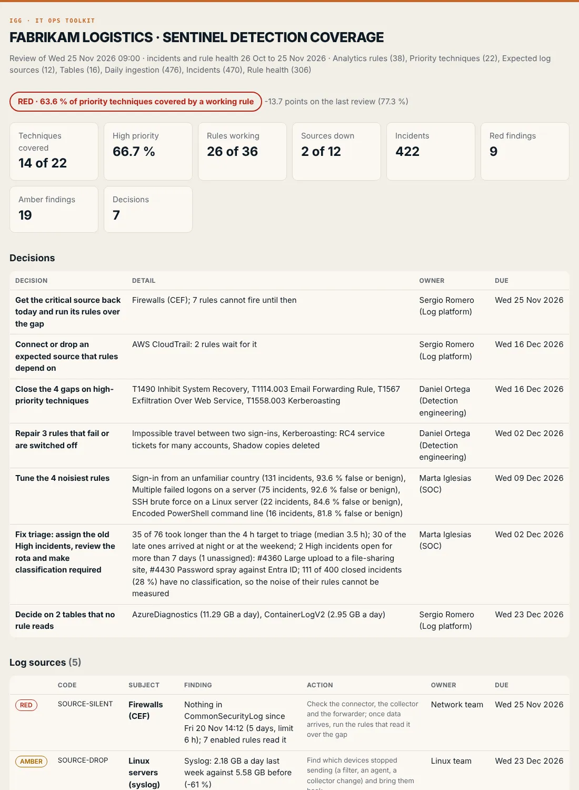

# Sentinel Detection Coverage

The question for the security operations team once a month: would Microsoft Sentinel see the attacks that matter to this organisation, today? It reads the analytics rules next to the organisation's priority MITRE ATT&CK techniques, the log sources the rules depend on, rule health and the incidents of the last 30 days, and puts together:

- **Log sources:** expected sources that went silent, never arrived or dropped sharply, and big tables that no rule reads.
- **Analytics rules:** rules that are blind because a table they read is silent, rules failing in the health log, rules switched off while they cover a priority technique, rules with no ATT&CK mapping and rules on an old template version.
- **Technique coverage:** each priority technique covered by at least one rule that works today, covered only by broken rules, or not covered at all.
- **Incidents and noise:** rules whose incidents are nearly all false or benign positives, slow triage (and when it is slow), High incidents left open and incidents closed with no classification.

Every finding has an owner and a due date, the share of priority techniques with a working rule is the **score**, the choices (get a source back, close the gaps, repair rules, tune the noisy ones, fix triage, decide on tables nobody reads) become **decisions**, and `detection-pack.md` is the page for the security operations review.

Python 3.10+, standard library only. It runs with fictional demo data out of the box. A read-only PowerShell script exports what it needs from the workspace.

It sits next to [52-endpoint-security-coverage](https://github.com/inigogonzalezgarcia/52-endpoint-security-coverage), which checks that every laptop and desktop has its security tools, and [36-major-incident-command-kit](https://github.com/inigogonzalezgarcia/36-major-incident-command-kit), for what happens once an incident is real.



## Why

Detection coverage gets lost quietly. A rule looks fine in the list of analytics rules while it cannot fire:

- a firmware upgrade on the firewalls stops the log forwarder, and every rule that reads the firewall table goes quiet with nothing to say why;
- the rule for shadow copy deletion was switched off during a backup migration and nobody switched it back on;
- a Kerberoasting rule times out every hour since the domain controllers started sending more events;
- the rules people trust are mapped to techniques; the four written last spring are not mapped to anything;
- one rule raises a third of all incidents, nine in ten of them benign, and the High incidents that arrive at night wait until morning.

The review reads the rules, the sources and the incidents together against the organisation's own priorities and turns them into a short list of decisions. The priorities are in `priorities.csv`, the expected sources in `sources.csv`, the limits and targets in `settings.json`; the rules are in `detcover/checks.py`.

## What it checks

| Area | Code | Finding | Severity |
|---|---|---|---|
| Log sources | SOURCE-SILENT, SOURCE-MISSING | An expected source stopped or never arrived | RED if critical, AMBER otherwise |
| Log sources | SOURCE-DROP, TABLE-NO-RULES | Volume down sharply; a big table no rule reads | AMBER |
| Analytics rules | RULE-BLIND | Rules that read a silent or missing table | RED if it is their only table, AMBER otherwise |
| Analytics rules | RULE-FAILING | The last run failed; or runs failed now and then | RED; AMBER |
| Analytics rules | RULE-DISABLED, RULE-NO-MAPPING, RULE-OUTDATED | Off while covering a priority; no technique; old template version | AMBER |
| Technique coverage | GAP-NONE, GAP-BROKEN | A priority technique with no enabled rule, or only broken ones | RED if high priority, AMBER if medium |
| Incidents and noise | RULE-NOISY, TRIAGE-SLOW, UNCLASSIFIED | Mostly false or benign positives; triage over the target; no classification | AMBER |
| Incidents and noise | TRIAGE-OPEN | High incidents open for more than a week | RED |

The priority techniques and the limits are this tool's example of an organisation's own choices, not a vendor's or a standard's. [docs/data-format.md](docs/data-format.md) has every rule, column, setting and how the score is calculated.

## Outputs

| File | What |
|---|---|
| `report.html` | Score with its trend, tiles, decisions, every finding by area, the priority techniques, log sources, rules, noise per rule and triage |
| `detection-pack.md` | One page for the security operations review: result, decisions, red findings, headlines, techniques and sources |
| `coverage.csv` | Each priority technique with its rules, how many work and its status |
| `sources-review.csv`, `rules-review.csv` | Each expected source with its last record, volume and rules; each rule with its state, incidents and noise |
| `noise.csv` | Incidents per rule by classification, with the share of false or benign positives and the median triage time |
| `findings.csv`, `actions.csv` | Every finding with severity, owner and due date; the same as actions with a reference and a done column |

## Try it

```bash
git clone https://github.com/inigogonzalezgarcia/63-sentinel-detection-coverage.git
cd 63-sentinel-detection-coverage
python -m detcover demo
```

Open `output/report.html` and `output/detection-pack.md`.

### The demo data

The demo is a made-up logistics company, Fabrikam Logistics, reviewing its Sentinel workspace on Wednesday 25 November 2026: 38 analytics rules, 22 priority techniques, 12 expected log sources, a month of daily ingestion, rule health and 422 incidents. The incidents follow the rules: a rule stops raising them on the day its table went silent or its query started failing.

Everything is fictional: names, rules and figures. The problems are placed on purpose:

- **Log sources:** the firewall table has been silent since Friday 20 November at 14:12; Linux syslog dropped 61 % after a configuration change; AWS CloudTrail is expected but never arrived; two tables send 14 GB a day that no rule reads.
- **Rules:** seven rules read the firewall table and two read CloudTrail; the Kerberoasting rule has timed out every hour since 14 November; the shadow copy rule was switched off in September; four rules have no technique and three are on an old template.
- **Coverage:** email forwarding rules have no rule at all; both rules for exfiltration to file-sharing sites need the firewall table.
- **Incidents:** "Sign-in from an unfamiliar country" raised 131 incidents, 94 % of the classified ones benign or false; 35 of 76 High incidents waited longer than four hours, 30 of them at night or at the weekend; two High incidents have been open for more than a week; 28 % of closed incidents have no classification.

The result: **RED**; 14 of 22 priority techniques (63.6 %) covered by a working rule, 13.7 points down on the last review, 66.7 % of the high-priority ones; 26 of 36 enabled rules working; 9 red and 19 amber findings and 7 decisions.

## Use it with your own data

1. Export (read-only):
   ```powershell
   .\scripts\Export-SentinelDetectionCoverage.ps1 -SubscriptionId <id> -ResourceGroup rg-security -Workspace law-sentinel -OutputFolder .\data -Days 30
   ```
   It uses Az PowerShell with Microsoft Sentinel Reader and Log Analytics Reader on the workspace and changes nothing. It reads the rules and their templates through the Microsoft.SecurityInsights API and queries `Usage`, `SecurityIncident` and `SentinelHealth`; the health table needs the Sentinel health feature switched on.
2. Write `data/sources.csv` and `data/priorities.csv` (start from `sample_data/`) and adjust `data/settings.json`: the limits, targets and owners ([docs/data-format.md](docs/data-format.md)).
3. Build the outputs:
   ```bash
   python -m detcover review data/
   ```

[docs/review-runbook.md](docs/review-runbook.md) has the monthly cycle, what to do when a source comes back after a gap, when a gap counts as closed, how to tune a noisy rule and what to keep as evidence.

The exports contain rule logic, incident titles and analyst names. Keep them inside your organisation:

- real files at the top level (`rules*.csv`, `incidents*.csv`, `sources*.csv`, `priorities*.csv`, `settings.json`, `data/` and the rest) and the `output/` folder are excluded from Git by `.gitignore`;
- only the fictional files in `sample_data/` are committed.

## Tests

```bash
pip install -r requirements-dev.txt
python -m pytest -q
```

GitHub Actions runs them on Python 3.10 and 3.12 on every push, checks that the committed sample data is what the simulator writes, and keeps the demo report and a screenshot as build artifacts.

16 tests: technique IDs and how a rule covers a sub-technique; a workspace with no findings; a silent critical source that blinds its rules and opens a gap; a missing source and a rule that is blind only in part; a volume drop; a big table with no rule; a failing rule and a flaky one; a disabled rule on a priority technique; unmapped and outdated rules; a noisy rule that needs enough classified incidents; slow triage at night and an old open High incident; unclassified incidents; other column names and missing files; the demo end to end; demo incidents that follow the sources; and a deterministic demo.

## Next steps

- Run it every month and keep the score as `previous_score`.
- Read the rule queries for watchlists and functions, and check those are populated too.
- Add the result of each gap's test (the safe simulation) next to the technique.
- Send the silent critical sources to the platform team's channel as soon as they go quiet, not once a month.

## Background

Built from my work in security operations and Microsoft 365:

- Microsoft Sentinel, Azure Monitor and Log Analytics, and SIEMs such as Splunk and Google SecOps;
- Microsoft Defender and Entra ID, with Conditional Access configured and managed;
- leading the technical response to major incidents and the post-mortems, and defining security metrics and KPIs.

Written from scratch with fictional data; no employer data, systems or exports are used.

## Customisation and contact

Want this adapted to your environment? For example:

- your own priority techniques from your threat model;
- the rule queries from your repository instead of the workspace;
- sources from other SIEMs next to Sentinel;
- the pack in your team's wiki or ticketing tool.

Get in touch:

- Website (contact form): [inigogonzalezgarcia.github.io](https://inigogonzalezgarcia.github.io/about.html#contacto)
- LinkedIn: [linkedin.com/in/igonzalez93](https://www.linkedin.com/in/igonzalez93)

## License

MIT
